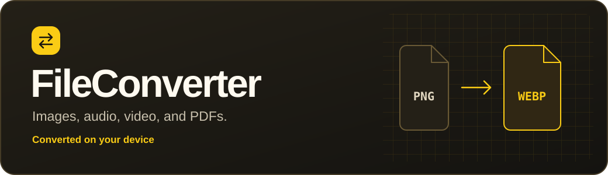
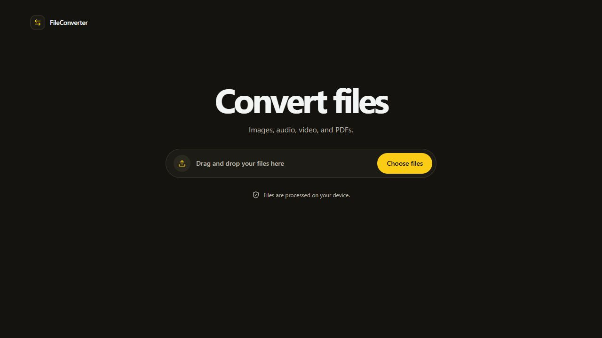

# FileConverter



Convert media and work with PDFs directly in your browser. Choose a file, pick an output format, and download the result.

[](https://nerdblud.github.io/FileConverter/)

## Preview

[](https://nerdblud.github.io/FileConverter/)

## Privacy and safety

FileConverter is designed to protect your files by keeping conversion on your device. **The app does not upload your selected files or converted results.** Media conversion runs in a Web Worker, and PDF operations run locally in your browser.

The hosted app loads from GitHub Pages. On the first media conversion in a session, your browser may download the FFmpeg WebAssembly engine from unpkg. That download does not include your files.

## What you can convert

| Type | Output formats and operations |
| --- | --- |
| **Images** | PNG, JPG, JPEG, WebP, BMP, TIFF, ICO, TGA, PPM, PGM, PBM, PCX, XPM, QOI, PAM, DPX, JP2 |
| **Audio** | MP3, WAV, AAC, FLAC, OGG, M4A, Opus, WMA, AIFF, AC3, AMR, M4R, MP2, CAF, AU, MKA |
| **Video** | MP4, WebM, MKV, AVI, MOV, WMV, FLV, 3GP, TS, M2TS, NUT, OGV, MPG |
| **Animation** | GIF, APNG |
| **PDF** | Merge PDFs or combine images into a PDF |

Available output formats depend on the input. After selecting a file, use **Browse all formats** to see the choices. Supported conversions offer options for audio bitrate, video resolution, or GIF frame rate. Open **Conversion log** to inspect progress and FFmpeg messages.

## Run locally

You need Node.js 20.19+ in the 20.x line or Node.js 22.12 or later, plus npm.

```bash
git clone https://github.com/NerdBlud/FileConverter.git
cd FileConverter
npm ci
npm run dev
```

Open [http://localhost:5173](http://localhost:5173) or the URL printed by Vite.

To build and serve the production bundle locally, run:

```bash
npm run build
npm run preview
```

## Tech stack

React 19, TypeScript, Vite, Tailwind CSS, FFmpeg.wasm, pdf-lib, and Lucide.

## License

[MIT](LICENSE)
